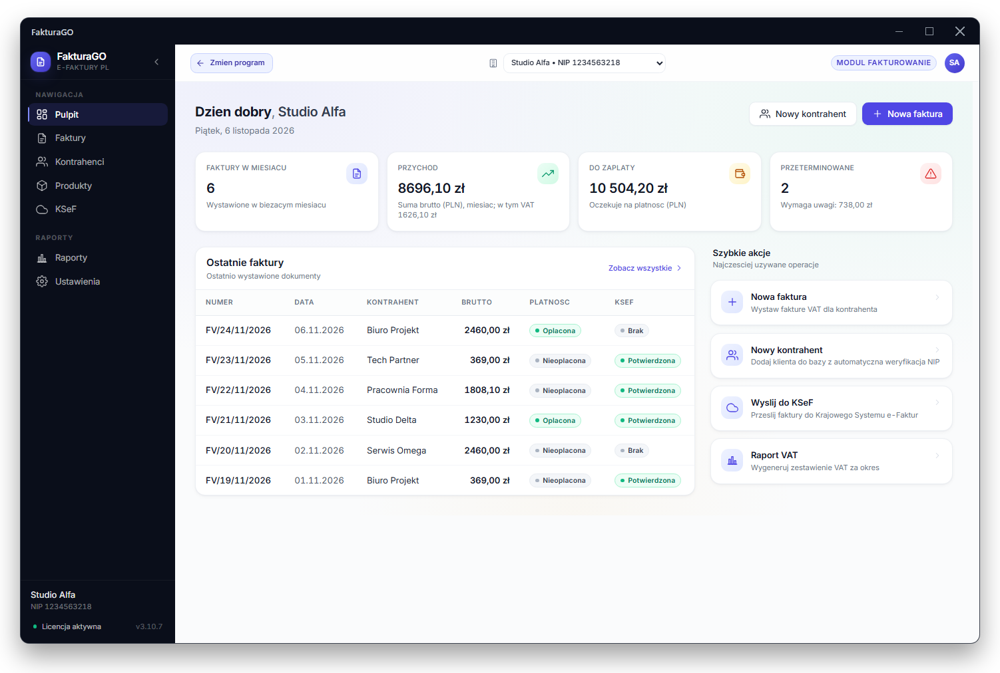

<samp>

┌

<b>Welcome</b> 
<b>I'm Bartosz Bobiński, a Software Engineer.</b>

<picture>
  <source media="(prefers-color-scheme: dark)" srcset="./typing-dark.svg">
  
</picture>

┘

</samp>

<samp><b>More Info</b></samp>

 

<samp>

<b>Now</b> 
Building <a href="https://fakturago.pl">FakturaGO</a>, a Windows invoicing application integrated with KSeF 2.0, Poland's national e-invoicing system. I designed, built and released it on my own: the desktop app, the licence and update server, Stripe subscriptions and the website. About 90,000 lines of TypeScript, from v1.0 to v3.11 in ten months. It is sold by subscription, so the code is closed.

</samp>

<samp>

<b>Stack</b>

<picture>
  <source media="(prefers-color-scheme: dark)" srcset="./stack-dark.svg">
  
</picture>

<b>How I work</b> 
With AI coding tools (Claude Code) every day. I answer for the architecture, the releases and production support myself.

<b>Contact</b> 
<a href="mailto:bobiskib@gmail.com">bobiskib@gmail.com</a> · <a href="https://fakturago.pl">fakturago.pl</a>

</samp>

